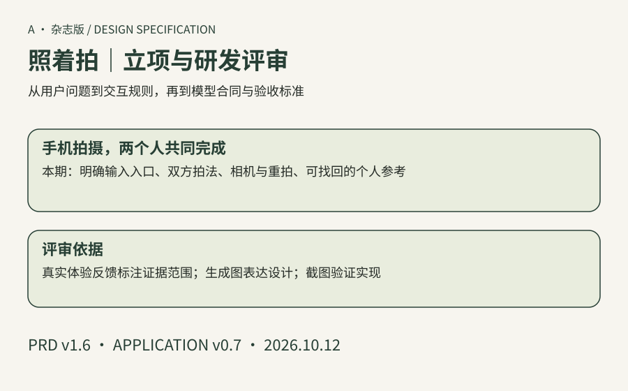

# 照着拍 · A · 杂志版

本版手机产品、评审文档和用户手册独立交付。应用 v0.7.0 / PRD v1.6。

- [立项与研发评审 PRD](prd.md)：真实反馈与证据范围、设计图、交互状态、模型协议和验收门槛。
- [用户手册 PDF](../../../downloads/magazine-handbook-v0.7.pdf?raw=true)：下载后用浏览器或系统 PDF 阅读器打开。
- [离线图文手册](../../../downloads/magazine-handbook-offline-v0.7.html)：下载后可单独阅读。
- [本版手机体验包](../../../downloads/zhaozhepai-magazine-v0.7.zip)：整个文件夹部署后体验。
- [双版本截图](../../ui-preview/mobile-v0.7/README.md) · [交付步骤](../../delivery-v0.7.md) · [验收记录](../../acceptance-v1.6.md)

GitHub 是私有仓库。请在浏览器登录有权限的账号；下载文件可用文件页右上角的 Download raw file。聊天里的本地文件预览不能可靠阅读 PDF。产品相机从 HTTPS 网址使用，手册文件可下载阅读。
