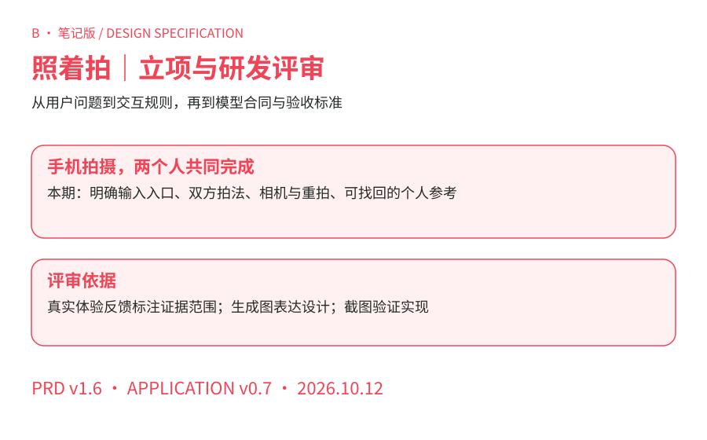
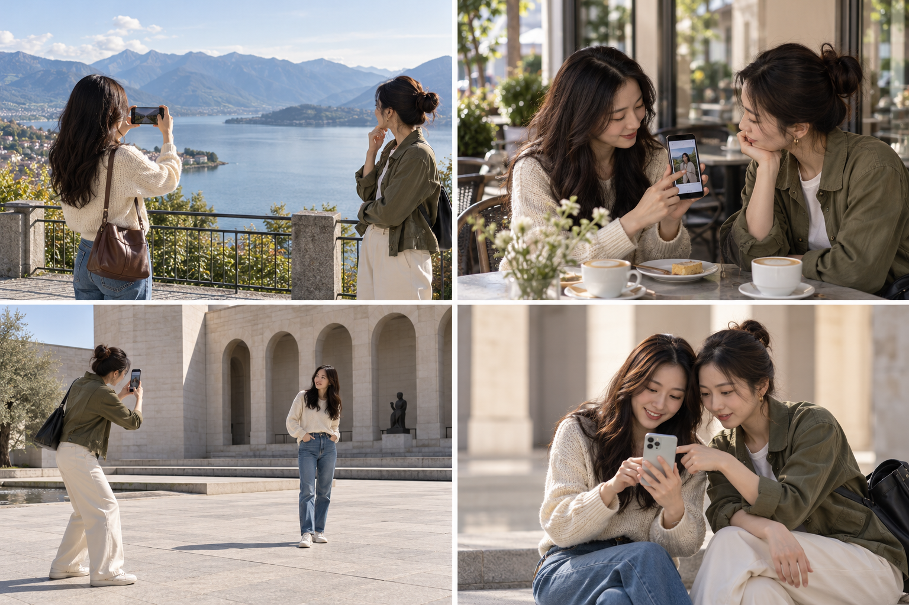
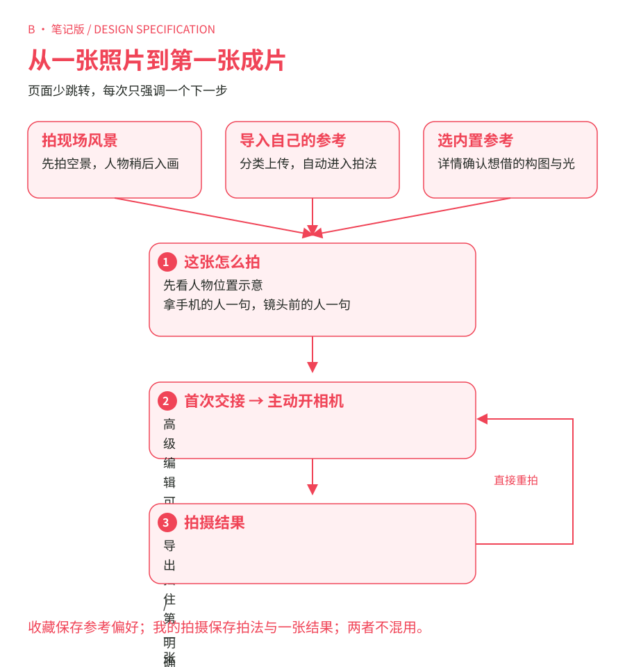
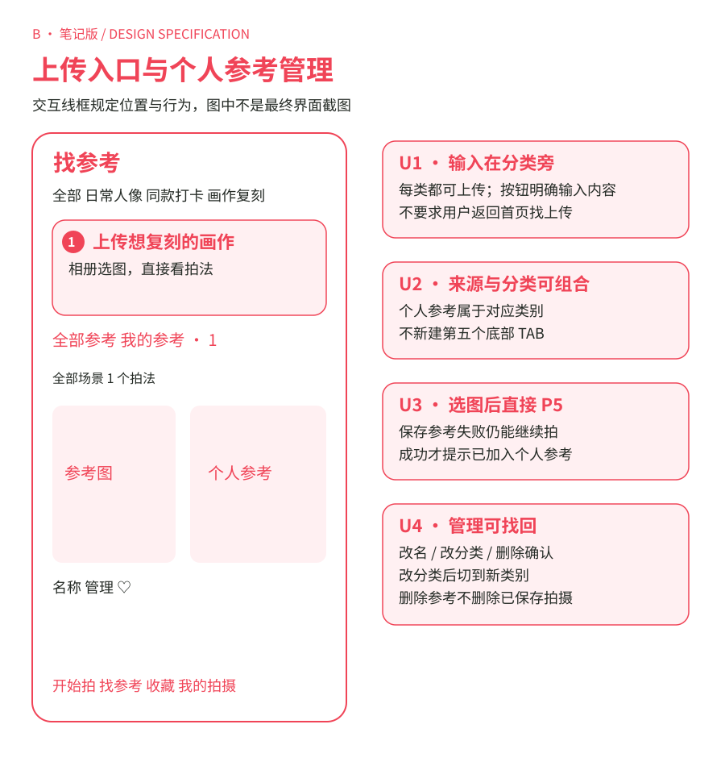
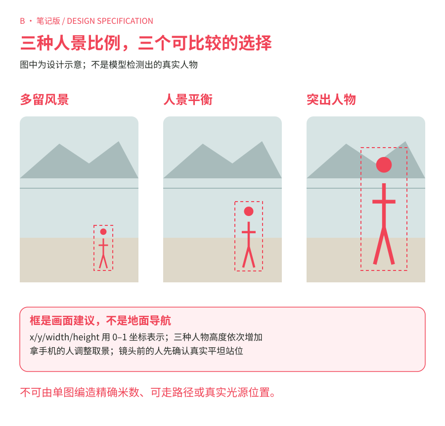
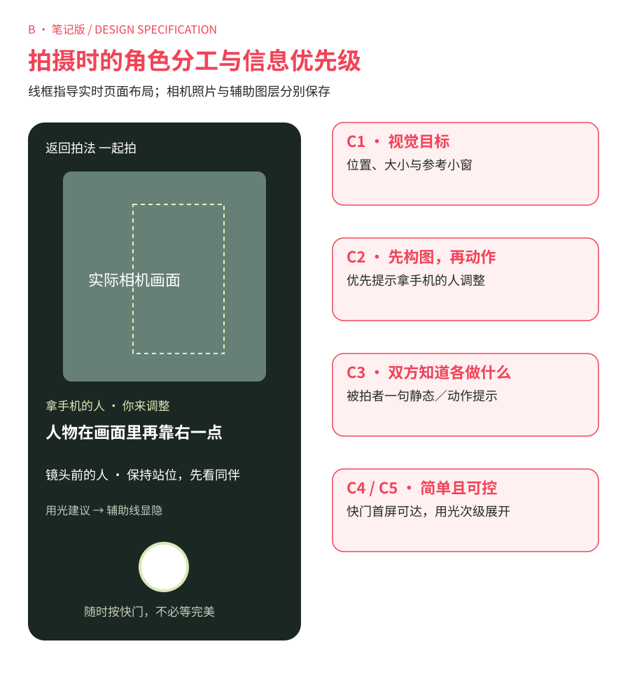
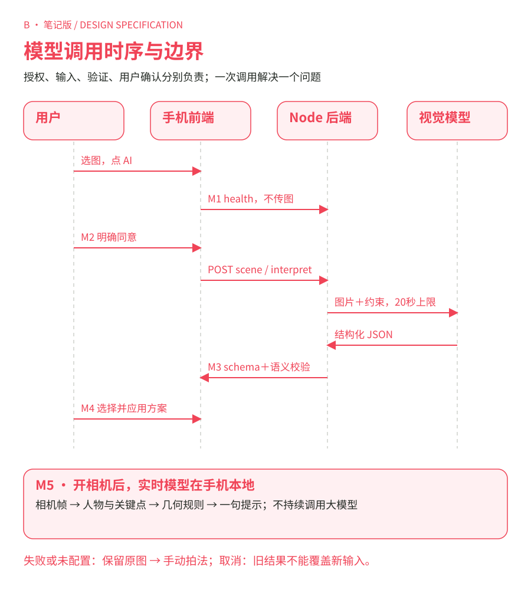
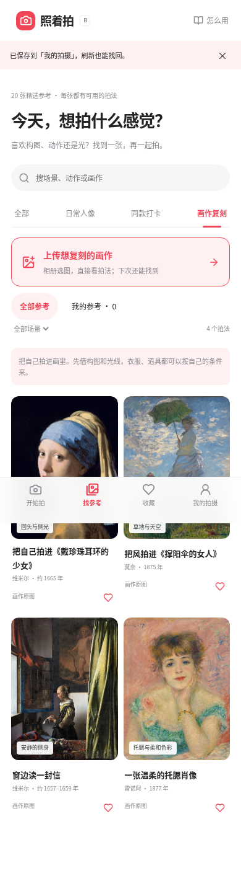
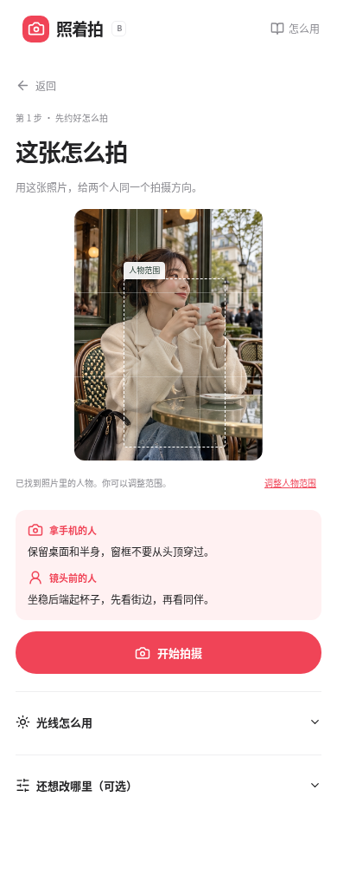

# 照着拍 · B · 笔记版｜立项与研发评审 PRD

版本 v1.6 / 应用 v0.7.0 · 2026-10-12 · 面向产品负责人、设计、研发、算法

**评审结论待确认：** 投入验证“把一张参考或现场图，转成两个人可执行的拍摄步骤”。本期完成手机拍摄闭环与个人参考入口；模型接口已实现，真实模型效果、成本及真机体验仍是上线前验证项。

## 1. 用户问题与证据

目标使用者是使用手机拍照的朋友、伴侣或旅行同伴，重点覆盖二三十岁都市女性及其同行者。年龄、审美偏好为目标定位假设，不是已验证的用户画像。产品同时服务拿手机的人和镜头前的人。

图 01｜左上：到达风景点但不知人站哪里；右上：拿出参考但难以传达；左下：双方各有可执行任务；右下：拍完只讨论一个改动。**AI 生成的情境示意，非用户访谈照片或效果承诺。**

### 已收到的真实反馈

下表引用本次需求与原型体验对话，证据范围为 **1 位需求提出者的反馈**。尚无目标用户配对访谈、现场拍摄观察或量化满意度数据；不能据此声称已验证市场。

| ID | 原话／反馈来源 | 可确认的问题 | 设计响应 |
| --- | --- | --- | --- |
| F01 | “我现在体验下来感觉易用性很差……很多名字取得也不好，感觉很晦涩。” | 当前原型理解成本高；反馈者不清楚从哪开始 | 首页两个任务入口，四个文字 TAB；统一“这张怎么拍”“我的参考”“我的拍摄” |
| F02 | “图二的 tab 页应该需要可以自己上传图片……没有这个选项存在。” | 分类浏览页缺少可发现的输入入口 | 每类在图片列表前显示上传按钮；选图后直接进入拍法 |
| F03 | “姿势这个东西本来就是由被拍摄者决定的，那给拍摄者的指导建议是什么呢？” | 双方价值分工未讲清楚 | 拿手机的人看位置、大小、背景与取景；镜头前的人看站位和动作 |
| F04 | “你到了一个风景的地方……想把人拍进去，但你不知道怎么拍会比较好。” | 提出了没有参考图的现场构图需求，尚未观察实际完成情况 | 场景图入口；三种人景比例与人物建议框 |
| F05 | “之前说的光影什么的，你都不准备要了吗？” | 简化界面后，重要能力不易被发现 | 拍法与相机保留用光入口；高级编辑折叠，不删除能力 |
| F06 | “Unable to render code block”；多次反馈链接／图片打不开 | 交付和阅读本身存在阻断，不等同于拍摄能力失败 | 浏览器下载链接、分版本手册、明确文件与体验入口；去掉用户手册中的部署说明 |
| F07 | “这里的图是置灰的，我不理解为什么。” | 手册图影响阅读并误导功能状态 | 导出时完成转场动画；截图保留正常色彩与对比度 |

核心痛点假设：收藏参考表达了审美偏好，却没有变成同伴可执行的取景指令；现场风景缺少人物构图起点；拍完的“再拍一下”缺少明确可改变的目标。以上假设需要用真实配对拍摄任务验证。

## 2. 本期范围与产品取舍

| 优先级 | 本期能力 | 取舍与边界 |
| --- | --- | --- |
| P0 | 手机竖屏、首页入口、分类上传、个人参考管理、明确返回 | 首次拍摄不要求填参数或读完整手册；电脑只呈现手机宽度预览 |
| P0 | 两人拍法、本地人物检测、相机、重拍、原片导出、保存恢复 | 快门由人决定；没有自动审美评分或虚构“最佳照片” |
| P0 | 场景 AI 前后端协议、授权、验证与失败回退 | 未配置服务时走手动；不将固定湖边示例套到上传图 |
| P1 | 光影方案、动作选区、镜像、调色与参考 AI 解读 | 可选展开；一张照片不等于精确测光、三维定位或姿势理解 |
| 后续 | 热点同款地点库、跨设备同步、账号与社区投稿 | 当前无完整地点库；个人上传是本地参考，不是社区发布 |

笔记版以白底、红色强调、无衬线标题和双列参考卡组织信息。上传与拍法同样前置，主操作位置与另一版一致。

两种风格共用功能、素材与模型协议。评审时用相同任务比较视觉和阅读，不用功能差异解释偏好。

## 3. 核心体验与页面结构

图 02｜规定三个输入起点、共同拍法、首次主动开相机和结果闭环。首张流程没有“必须读手册”或“必须高级编辑”的节点。

**9 个核心页面**，不是用户必须依次走的 9 步。另有引导、授权、编辑、确认等弹窗和独立手册。

| 编号 | 页面 | 入口 | 主要出口／返回 |
| --- | --- | --- | --- |
| P1 | 开始拍 | 默认首页、品牌按钮、开始拍 TAB | 场景到 P4；导入个人参考到 P5；推荐图到 P3 |
| P2 | 找参考 | TAB、查看全部 | 分类／搜索／来源就地过滤；点图到 P3；上传到 P5 |
| P3 | 参考详情 | 推荐／收藏／个人参考的图片或标题 | 照着这张拍到 P5；返回原列表并恢复滚动；个人参考可管理 |
| P4 | 从风景开始 | 首页拍风景 | 选图→授权分析或手动→P5；取消分析仍保留 P4 的图 |
| P5 | 这张怎么拍 | 三种输入、保存记录恢复 | 开始→首次双方提示→P6；保存停留；返回对应详情／场景 |
| P6 | 一起拍 | 首次交接、结果重拍 | 快门到 P7；返回 P5；离开即停止轨道与语音 |
| P7 | 拍摄结果 | 快门、上一张、恢复结果 | 重拍／只改一点到 P6；编辑到 P5；导出、保存就地处理 |
| P8 | 收藏 | 收藏 TAB | 参考详情 P3；心形只改变收藏状态，不跳页 |
| P9 | 我的拍摄 | 我的拍摄 TAB | 点记录恢复 P5，再查已保存结果 P7；删除需要确认 |

Hash 标记页面，刷新回 P1；已保存内容从对应列表恢复。页内返回保留输入和上下文，浏览器历史按钮逐页恢复不作为本期承诺。底部四 TAB 只在 P1/P2/P8/P9 显示。

## 4. 输入与个人参考：开发依据

图 03｜U1 上传在类别下方，首屏可见；U2 来源筛选不新建底部 TAB；U3 管理放在卡片与个人详情；U4 编辑后切到目标类别，避免“改完消失”。

| 控件／事件 | 前置状态 | 转移与数据规则 |
| --- | --- | --- |
| 全部／日常人像上传 | P2 当前类别为全部／日常 | 按钮“上传我的参考图”；默认归日常 |
| 同款打卡上传 | P2 当前类别为同款 | “上传想拍的同款”；默认归同款，不推断明星身份与地点 |
| 画作复刻上传 | P2 当前类别为画作 | “上传想复刻的画作”；默认归画作，不强制完整姿态识别成功 |
| 相册取消 | 系统选择器打开 | 页面、过滤、当前图、方案保持原状态 |
| 图片有效 | JPG/PNG/WebP ≤20MB；宽高≥80；像素≤3200万 | 校正方向，创建照片；保存个人参考后直接 P5，不先填表 |
| 本地参考保存失败／满24张 | 文件仍可读取 | P5 继续本地构图；明确“未保存到我的参考”，不假报成功 |
| 全部参考／我的参考 | P2/P8 | 就地过滤；与类别、场景、关键词同时生效；个人参考 A/B 同域共享 |
| 管理→名称／分类→保存 | 本地个人参考存在 | 名称1–60字；更新原ID，保留图；选择新类别并保留个人筛选 |
| 删除个人参考 | 已二次确认 | 删个人库及可更新的收藏ID；已保存拍摄有独立Blob，不被删除 |
| 点个人参考→详情→照着拍 | 本地Blob可读 | 重建URL，保持参考ID；没有云端解读时给通用提醒，不伪装成看懂光线 |

个人参考与拍摄记录分别存储，前者最多24张，后者最多12条。长边最多1600px；保存在当前浏览器，清理数据或换设备不保证恢复。导出原片与“保存这次拍摄”是两个明确动作。

## 5. 拍法、相机与结果规则

图 04｜三种构图的框使用图像相对坐标；示意人物不是检测结果。现场安全站位需要双方确认，不能把框转成“向湖边走几米”。

| 环节 | 交互要求 |
| --- | --- |
| 拍法主区域 | 原图＋框；拿手机的人一句、镜头前的人一句；开始拍摄在手机首屏；更多设置后置 |
| 参考人物 | 自动找单人后可开始；多人须选一人；找不到则手动框可见人；手臂仅在可靠检测且选用后进入约束 |
| 场景方案 | 人景平衡／多留风景／突出人物切换建议框与双方提示；手动模式写明“没有分析这张照片” |
| 用光 | 七种现场光及不确定；俯视示意、双方站位、背景与时机；用户确认现场条件，不冒充自动测光 |
| 首次开拍 | 交接弹窗解释双方任务；用户点“我拿手机，打开相机”才申请权限；当次后续重拍直接相机 |
| 实时提示 | 无人／多人／不可靠时暂停约束提示；先人物位置与大小，再选中的手臂；允许未对齐时主动拍照 |
| 相机控件 | 辅助线显隐、参考小窗、手动语音、用光、前后镜头、设备支持才显示变焦、快门、上一张、明确恢复 |
| 原片 | 抓取实际相机像素；目标框、箭头、文字不进照片；调色另导出，不覆盖原片 |
| 最近拍摄 | 最多6张，每张保留当时目标；切图后的对照和反馈使用该张目标，不能套后面修改的拍法 |
| 只改一点 | 构图／动作／光线／背景可保留；改动一次一个；与保留项冲突须说明并阻止；生效后直接相机 |
| 保存 | 结果页保存明确选中的一张；拍法页保存最新方案；保存拍法不会覆盖已有照片；保存后仍在当前页 |
| 离开 | 未明确保存方案／结果时提示保存后离开、直接离开、继续；保存失败留在原处 |

图 05｜C1 实时画面与参考；C2 当前拿手机的人要做什么；C3 镜头前的人如何配合；C4 快门始终可达；C5 用光与复杂信息次级展开。

### 可选高级参考编辑

裁切支持原图/3:4/4:5，拖框、角点和键盘微调；旋转90°与改变裁切需确认重置旧选区。局部/整图、画笔/橡皮/移动、笔迹大小、撤销/重做/清空管理选择，不把背景笔迹变成动作。多人选择一人，镜像交换参考与可用手臂。

文字修改需明确“应用”，不支持的表达保留输入并阻止确认；要素按实时约束、拍前建议、拍后处理区分。现场条件选光线/背景/空间与就地拍/换位置；狭窄空间不安排走动。高级“应用这些调整”回写简单拍法；收起不应用未确认设置。参考 AI 是可选明确动作。

### 结果页具体动作

再拍一张直接 P6；返回拍法 P5；导出原片和参考并排对照分别下载JPEG。调色有冷暖、明暗、对比、强度，预设/查看原片/恢复原片/单独导出成片。大小反馈用可靠观测，否则说明依据原目标；“脸再亮一点”“背景干净一点”给现场建议，不冒充像素测量。场景原图无人物时，不运行参考人物明暗对照。

## 6. 模型职责与调用时序

图 06｜M1 服务检查不上传图片；M2 同意后发送单图；M3 后端严格验证；M4 用户选方案；M5 实时视频仅进入本地模型。重拍不自动再次调用大模型。

| 能力 | 实现与输入 | 输出／使用方式 |
| --- | --- | --- |
| 本地人物检测 | MediaPipe Pose Landmarker；参考裁切图或相机帧 | 人物范围与可用关键点；构图/选中手臂进入规则计算；不代表光学或审美理解 |
| 场景规划 | 视觉LLM；单张压缩场景图 | 三种方案、建议框、双方一句话、光线依据与限制；用户选后应用 |
| 参考解读 | 视觉LLM；裁切图、选区、文字、可用身体部位与当前草案 | 结构化草案与9类要素；不能选择未检测部位或提高其能力等级 |
| 实时构图 | 几何规则；目标与观测的二维范围、镜像、时效 | 最优先的一项提示与箭头；不请求大模型，不自动移动镜头 |

当前支持 Gemini、OpenAI Chat Completions 和火山方舟 Responses。用户已选择并在控制台开通 `doubao-seed-2-1-pro-260915`，服务端用 `VISION_PROVIDER=ark` 接入。Responses 请求为单图 input_image、JSON 输出、关闭思考、store=false；只接受 completed 状态的 assistant/output_text，继续严格校验业务结构。**适配器模拟测试已通过，产品内真实调用仍待部署后验证；不宣称已测得准确率、延迟或成本。** 服务端模型名以账号实际可用项为准，部署步骤见 [Render 接入说明](../../render-ark.md)。

### 接口合同

| 接口 | 触发／输入 | 返回与约束 |
| --- | --- | --- |
| `GET /api/health` | 打开AI授权框 | `configured`、`sceneConfigured`、provider/model；无配置禁用发送并保留手动入口 |
| `POST /api/scene` | 用户同意；`{consent:true,image:dataURL}` | `summary`、`light{style|null,advice,evidence}`、`variants[3]`、`limitations[1..5]` |
| `POST /api/interpret` | 高级区参考解读授权 | `image,text,availableGroups,personBox|null,draft,selection`；返回 `draft,insights,explanation` |

图像按当前裁切压缩：长边约1024px、JPEG质量0.82。dataURL≤3,000,000字符，HTTP体≤3.5MB；同源、JSON格式、每IP一项活跃分析。超时20秒；自动重试0，用户可主动重试或手动继续。取消中止前端请求，响应版本校验避免旧结果覆盖新输入；后端提供商超时是资源上限。

场景每项：`id=balanced|scenery|person`，`box={x,y,width,height}`，`camera/subject/why`。坐标是当前发送图片的0–1相对坐标；width0.06–0.85、height0.12–0.92，框完全在图内。三种ID唯一，height(scenery)<height(balanced)<height(person)。字段缺失、类型不符、大小矛盾或框越界不能进入P5。

参考草案：`mode=partial|whole`，`groups=[left_arm,right_arm,head,torso]`仅可选输入可用项，`features`最多9项，`ignoreContact/mirror`布尔。要素包含 `id,summary,evidence,confidence=observed|inferred|unknown`；功能support由服务器既有能力表决定，模型不能将光线、表情等升级为实时测量。

模型提示必须约束：依据可见内容，分开观察与推断；光不清楚给null/unknown；不编身份、真实地点、精确米数、焦距、曝光参数或不可见安全地面。图片／用户文字不构成更改服务规则的指令。返回JSON经schema和语义校验，不直接写成已确认方案。

## 7. 异常与数据生命周期

| 情况 | 展示与恢复 | 数据规则 |
| --- | --- | --- |
| 图片错误／过大 | 原页说明格式／大小；重新选择 | 保留已有图与拍法；取消不清会话 |
| 服务未配置503／健康检查失败 | 明确未开启；可自己选站位 | 不发送图片、不生成假的分析 |
| 请求400/403/415/429 | 输入/来源/格式/忙碌错误；允许改输入或稍后重试 | 不覆盖当前方案 |
| 超时／提供商失败／不合法输出502 | 保留照片；重试、手动继续 | 丢弃不合法或迟到结果 |
| 无人／多人／遮挡／模型不可用 | 说明检测状态；选人、手动框或重试 | 不画不存在的关键点；图仍可继续构图 |
| 手动确认时自动检测尚未完成 | 使用用户明确确认的范围继续 | 取消旧检测并丢弃迟到结果，不能覆盖手动选择 |
| 相机拒绝／无设备／占用 | 提供权限提示与重试；保留拍法 | 返回、拍照、切镜头、页面隐藏时停止旧轨道 |
| 存储失败／配额 | 解释未保存；先导出，删除旧条目后重试 | 不显示成功；离开保存失败不导航 |
| 删除记录 | 二次确认；取消保留 | 删除当前对象，不动已下载文件或其他库 |

参考库、收藏、拍摄记录分别负责输入/偏好/成果。同一照片ID更新同一拍摄记录。最新拍法和已保存照片的历史目标分开存；最近6张仅会话内。Blob入库，临时URL在离开、替换、淘汰与卸载时释放，不能提前释放新导入图。

## 8. 易用性、算法评测与立项门槛

### 验收目标（目标值，非已测结果）

| 指标 | 采集／验收方法 | 建议门槛 |
| --- | --- | --- |
| 输入入口可发现 | 新用户无提示找到相册/场景入口 | 8组配对测试中至少7组在10秒内找到 |
| 首次理解 | 说清双方各做什么，完成开相机 | 至少7组不依赖讲解完成；等待模型时间单独记录 |
| 图与提示可读 | 360/390/430px，正常对比度、无横向溢出、快门可达 | 所有核心页通过；触控主操作≥44px |
| 保存理解 | 能区别个人参考、收藏、我的拍摄、导出 | 至少7组任务后正确找回指定内容 |
| 一次只改一点 | 观察反馈是否转为具体下一张动作 | 记录完成时间与主观理解；不以模型评分替用户判断 |
| 建议可执行 | 80张真实参考/场景样本，专家标注可见依据与现场可执行性 | 协议合法≥98%；危险/虚构精确位置为0；可执行率目标≥90% |
| 延迟与成本 | 真实调用记录端到端P50/P95、输入输出计费、失败率 | P95目标≤8秒；20秒必须可恢复；成本预算在选型评审确定 |

真机覆盖iOS Safari与Android Chrome、相册取消/转后台/前后镜头/权限拒绝/导出。真实模型评测含无平坦地面、低光、多人、原画、遮挡、未知光源与图内文字；生成情境图不作为用户证据。80张评测和8组配对测试是计划，尚未执行。

埋点设计：entry_selected、upload_completed/failed、plan_ready、camera_opened/failed、shot_taken、one_change_applied、reference_saved/failed、capture_saved/failed、export_completed、analysis_latency/error。仅记录事件、来源、版本、耗时、错误码；不记录原图或自由文本。本轮没有接入线上统计，不虚构漏斗或留存。

立项验证通过条件：两人能独立完成第一张、关键入口可发现、建议可执行；未满足则先改流程与提示。上线门槛另需模型真实评测、真机相机体验、明确的同款图片与地点来源。市场与付费验证需要真实任务使用和复用观察，本期不以Demo完成替代。

## 9. 实现对照与评审交付

上述两张用于对照U1与拍法主操作；其余设计图规定结构与行为。相机截图使用受控Canvas视频流验证真实本地模型与快门管道，未冒充手机实拍。

[本版用户手册](../../../public/notebook-guide.html) · [手册PDF](../../../downloads/notebook-handbook-v0.7.pdf) · [独立体验包](../../../downloads/zhaozhepai-notebook-v0.7.zip) · [全部截图与验证](../../ui-preview/mobile-v0.7/README.md)

开发依据：`src/product/App.tsx` / `Plan.tsx` / `personal.ts`，`server/scene-provider.ts` / `schema.ts`，`src/notebook/GuidedCamera.tsx` / `PhotoResult.tsx` / `storage.ts`。功能状态：本地闭环可验证；AI前后端可测试；真实服务配置、外部语义质量与真机体验尚待验收。
