# 照着拍 PRD v1.5

交付应用版本：v0.6.0。日期：2026-10-12。本文描述实际实现的双版本产品，历史 v0.4 / v0.5 保留。

## 1. 定位、用户与取舍

照着拍帮助 **拿手机的人** 和 **镜头前的人**，围绕一张场景图或参考照片，共同完成喜欢的照片。服务对象包括二三十岁都市女性及其朋友、伴侣、旅行同伴。核心痛点是：收藏图表达了喜欢，却没有变成同伴可执行的指令；到了好看的地方，不知道人站哪里；拍完不满意，却只能说“再拍一下”。这些仍是待用户验证的产品假设，不能把 Demo 完成等同于市场验证。

当前实现优先做三件事：从照片开始，把双方各自的下一步说清楚；先拍一张，再只改一个地方；重要结果可以导出，参考与拍法可以本地找回。首页提供两个任务入口，四个底部 TAB。更多开关收进拍法页的可选区域，避免先填问卷、先学参数。

- **A 暖色版**：暖白、墨绿、衬线标题与留白，保留原有审美。
- **B 笔记版**：白底、红色强调、无衬线标题、圆角卡片与双列图片，参考常见拍法笔记的阅读方式。
- 两个版本共用内容、流程、相机、保存与后端协议，功能同步。原作品保存在旧 ZIP 和历史分支中。
- 没有虚构用户、点赞数、AI 审美评分或明星身份识别。当前是拍摄工具，不是已经运营起来的社区。

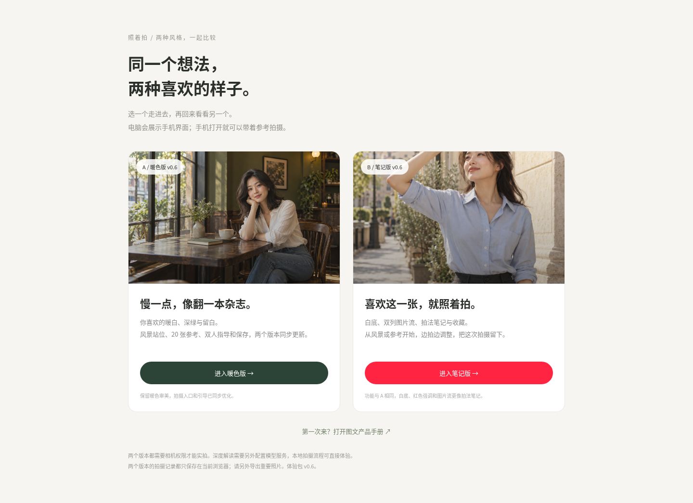

## 2. 交付范围与真实能力

| 能力 | 当前状态 | 使用条件 |
| --- | --- | --- |
| 两种风格、四个 TAB、三步示例、图文手册 | 可用 | 普通网页浏览 |
| 20 张参考及具体拍法、搜索、场景过滤、收藏 | 可用 | 素材随包提供，不依赖外链加载 |
| 导入个人参考、自动找人、手动确认人物、构图指导 | 可用 | JPG / PNG / WebP，20 MB 内，80×80 至 3200 万像素；端侧检测失败可手动继续 |
| 场景图 → AI 构图、人物建议框、双方提示、光线建议 | **接口、适配器、验证与前端已实现，当前环境未配置模型服务** | 部署 Node 后端并通过安全环境变量配置真实视觉模型；用户明确确认发送 |
| 场景图 → 自己选位置、三种比例、打开相机 | 可用 | 清楚标为通用建议，未分析该图 |
| 内置湖边示例 | 可用 | 清楚标为编辑整理的演示，不调用 AI、不冒充用户图片分析 |
| 实时人物范围、选中的手臂相对动作 | 可用 | 本地 MediaPipe 模型，可靠可见的人物；自动提示先构图后动作 |
| 七类光线、俯视用光图、机位与背景建议 | 可用 | 编辑方案和用户确认的现场条件；不是自动测光 |
| 重拍、最近 6 张、下一张只改一点、调色、干净原片 | 可用 | 相机需 HTTPS 和浏览器权限；硬件变焦按设备能力显示 |
| 保存参考＋拍法＋一张结果，删除，刷新恢复 | 可用 | 当前浏览器 IndexedDB，最多 12 条；图片长边最多 1600px |
| 同款打卡的实时热点与精确地点库 | **本次只提供 2 张真实赫本照片及出处** | 两张原拍摄地点未核实，不提供编造的地图；热门照片可个人导入，完整地点库待补充 |
| 账号、云相册、跨设备同步、实时视频发给大模型 | 未实现 | 不在当前体验范围内 |

## 3. 页面数量与导航

**核心产品共 9 个页面。** 双版本选择页 S0 和独立图文手册 H0 在核心流程之外。旧版归档入口也不计入本次 9 页。

| 编号 | 页面 | 入口与用途 | 主要下一步 |
| --- | --- | --- | --- |
| P1 | 开始拍 `#start` | 默认首页；风景、导入参考、上手示例 | P4 / P5 / P2 |
| P2 | 找参考 `#discover` | 四类参考，关键词搜索，场景筛选 | P3 |
| P3 | 参考详情 `#detail` | 原图、拍法、准备条件、出处、地点状态 | P5 |
| P4 | 从风景开始 `#scene` | 拍／传场景照片，明确发送后分析，或自己选站位 | P5 |
| P5 | 这张怎么拍 `#plan` | 站位图、双方各一句、主按钮；可选光线与高级调整 | P6 |
| P6 | 一起拍 `#camera` | 相机、构图／动作提示、快门 | P7；返回 P5 |
| P7 | 拍摄结果 `#result` | 对照、导出、重拍、反馈、调色、明确保存 | P6 / P5 / P1 |
| P8 | 收藏 `#favorites` | 收藏的参考；同样支持筛选 | P3 |
| P9 | 我的拍摄 `#mine` | 本地记录、继续、删除、说明保存边界 | P5，再进入 P7 / P6 |

底部导航只在 P1、P2、P8、P9 显示，顺序为 **开始拍 / 找参考 / 收藏 / 我的拍摄**。相机和结果页专注当次任务，通过“返回拍法”“再拍一张”等返回。除相机页外，顶部始终可打开“怎么用”；电脑侧边也可打开对比页与手册。

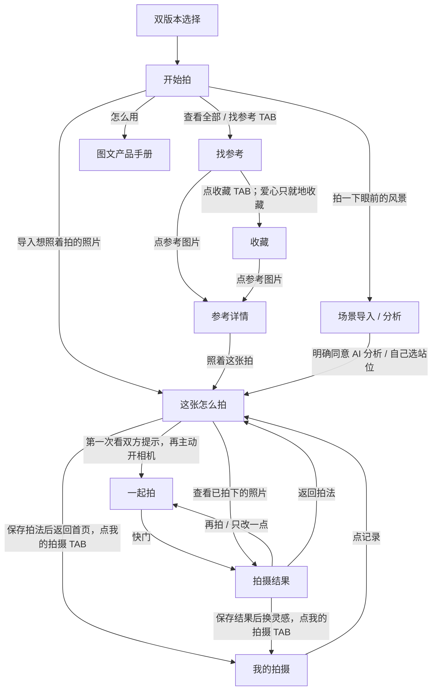

Hash 用于显示当前页面，不是服务器上的九条独立路由。刷新统一回首页；已保存记录从“我的拍摄”恢复。页内的返回按钮保留照片、拍法和当次拍摄上下文；参考详情返回列表时保留筛选、关键词和列表滚动位置。当前不承诺浏览器历史按钮逐页恢复未保存状态。

## 4. 逐页交互清单

### P1 开始拍

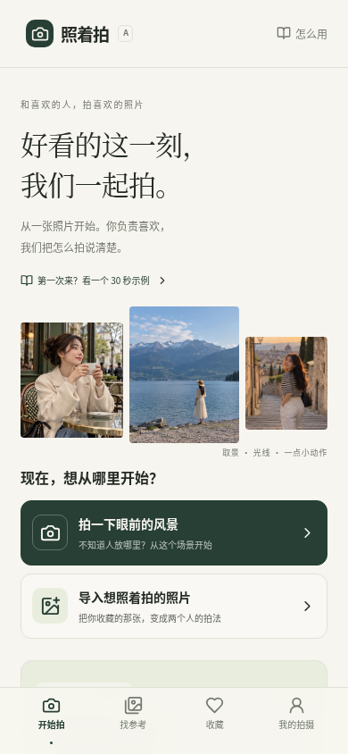

| 点击位置 | 行为／到哪里 | 状态与失败处理 |
| --- | --- | --- |
| 拍一下眼前的风景 | 清理旧会话，进入 P4 | 离开未明确保存的拍法／结果前给出保存选择 |
| 导入想照着拍的照片 | 打开系统文件选择；成功后直接 P5 自动确认人物 | 取消文件选择保留原状态；读取失败显示具体原因；不会先强制手动画框 |
| 第一次来？看一个 30 秒示例 | 打开 M1 三步演示 | 示例入口首屏可见；不启动相机、不发 API 请求 |
| 上手卡中的看一个示例 | 同样打开 M1 | 卡片介绍：选照片 → 看双方提示 → 拍一张 |
| 上手卡中的收起 | 收起大卡，并本地记忆 | 仍保留 30 秒入口和顶部“怎么用”；存储受限时当前页面照常收起 |
| 推荐图／标题 | 进入对应 P3 | 首页先展示 4 个可试拍法 |
| 推荐卡片爱心 | 收藏／取消收藏 | 写入失败给真实错误，不显示成功收藏 |
| 查看全部／找参考 TAB | P2 | 不改变当前筛选状态 |
| 收藏／我的拍摄 TAB | P8／P9 | 进入对应本地内容 |
| 怎么用 | H0 产品手册 | 同窗口，保留版本信息；拍法／结果未保存时浏览器可能提醒离开 |

### P2 找参考与 P8 收藏

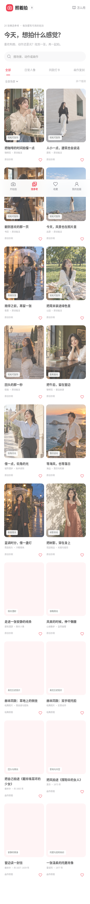
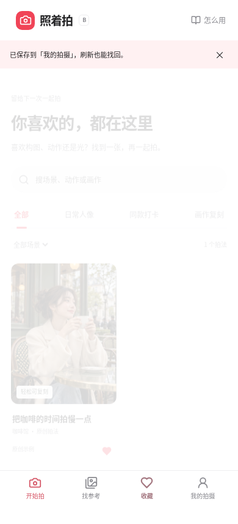

| 点击位置 | 行为／到哪里 | 规则 |
| --- | --- | --- |
| 搜索输入框 | 就地过滤，不跳页 | 匹配标题、场景、副标题、标签、出处；清除恢复当前类别 |
| 全部 / 日常人像 / 同款打卡 / 画作复刻 | 就地切换类别 | 同款与画作显示简短说明，场景筛选独立保留 |
| 场景下拉框 | 就地筛选咖啡馆、建筑、书店、出游、夜景、公园、街拍、室内 | 页中显示结果数量 |
| 图片／标题 | P3 | 记住来源页与滚动位置 |
| 爱心 | 收藏／取消收藏，不打开详情 | A/B 在同一站点共用收藏；只保存参考 ID，不保存拍摄结果 |
| 空列表“去找参考” | 清空关键词、类别和场景筛选，进入 P2 | P8 为空时解释如何点爱心 |

### P3 参考详情

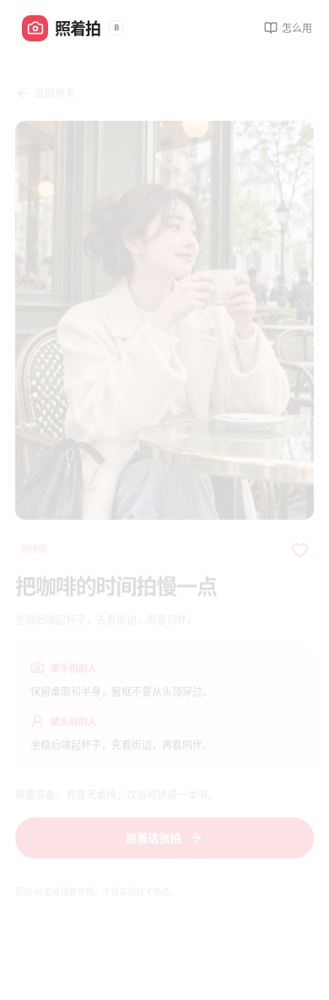
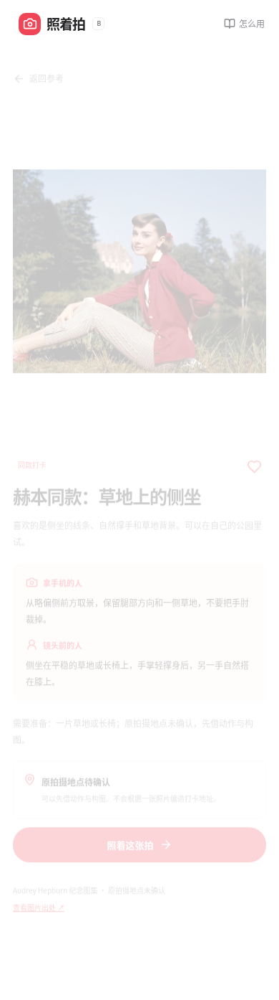
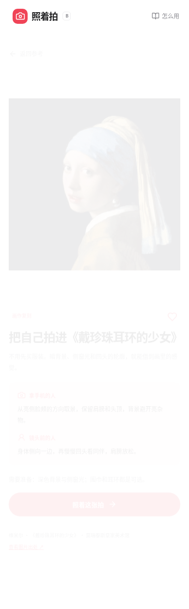

| 点击位置 | 行为／到哪里 | 规则 |
| --- | --- | --- |
| 返回参考 / 返回收藏 | 回 P2 / P8（首页推荐进入时回首页） | 保留筛选和滚动位置 |
| 爱心 | 收藏／取消收藏 | 不自动保存个人照片 |
| 照着这张拍 | 加载原参考，进入 P5 | 显示准备状态；图读不了保留详情并报错 |
| 查看图片出处 | 在新窗口打开注明的来源 | 生成图明确标为原创 AI 示例，不提供虚假的现实地址 |
| 地点信息 | 展示已确认／待确认状态 | 内置赫本参考为待确认；当前不显示可点击地图按钮。已核实地点数据才允许提供“打开地图” |

详情先展示原图，再给“拿手机的人”和“镜头前的人”各一句可执行建议，以及道具／时间／环境要求。画作使用原作原图，并允许只借光、构图或动作。配色、服装和表情供视觉参考，不做五官评分。

### P4 从风景开始

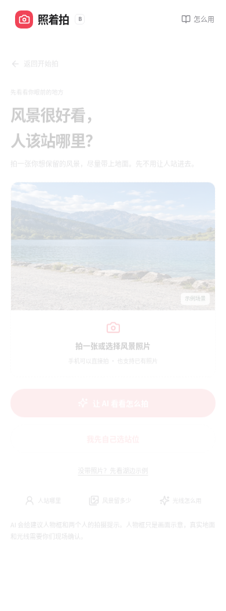

| 点击位置 | 行为／到哪里 | 状态与失败处理 |
| --- | --- | --- |
| 拍一张或选择风景照片 | 打开系统拍摄／相册控件；手机请求后置拍摄 | 输入图尽量包含地面，此步不要求人进入画面、不出现确认参考人物弹窗 |
| 换一张场景照片 | 再开系统控件；成功替换，取消保留原图 | 分析中禁用替换；图片校验与个人导入一致 |
| 让 AI 看看怎么拍 | 打开 M3 发送授权，并检查服务状态 | 只有点击“同意发送”才请求分析 |
| 同意发送，开始分析 | 留在 P4 显示进度；成功进入 P5 | 发送压缩后的当前图。失败保留原图，可重试或手动继续 |
| 不发送，我自己选站位／我先自己选站位 | P5 手动模式 | 清楚写“通用提示，没有分析这张照片” |
| 取消分析，保留照片 | 终止请求，仍在 P4 | 迟到响应不能覆盖后续选择 |
| 没带照片？先看湖边示例 | M1 | 不将示例结果应用到上传的照片 |
| 返回开始拍 | P1 | 拍法／结果存在未明确保存状态时先确认 |

AI 返回三种互不重复的构图：人景平衡、多留风景、突出人物。每种包含归一化人物建议框、给拿手机的人一句建议、给镜头前的人一句建议、可见画面依据。光线给出可见依据和不确定性。不推断精确米数、焦距或现实中的 3D 落点；不生成不存在的人体检测。

当前静态包 `/api/health` 明确返回未配置。不会静默伪造成功结果。真正分析通过同源 Node `/api/scene`，请求需要 `consent: true`，拒绝非同源请求、过大输入和不完整响应，模型调用有 20 秒超时。三种方案人物高度必须满足：多留风景 < 人景平衡 < 突出人物。

### P5 这张怎么拍

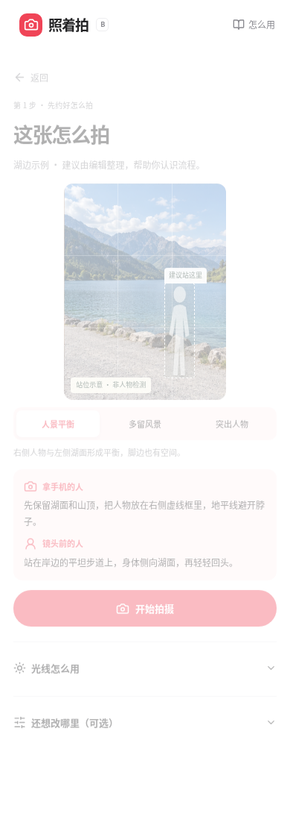

| 点击位置 | 行为／到哪里 | 规则 |
| --- | --- | --- |
| 开始拍摄 | 首次 M2 双方提示；本次后续直接 P6 | 自动确认或手动确认人物后才能开启参考模式；场景方案无需伪造人物观测 |
| 人景平衡 / 多留风景 / 突出人物（场景） | 就地更新建议框与对应提示 | AI／示例用对应方案；手动用明确的通用框 |
| 调整人物范围（参考） | M4 图片编辑器 | 可拖动框、四角和滑杆；明确确认后才能用手动画框指导构图 |
| 多人参考的“人物 1、2…” | 选定一个参考人物 | 无选择不进入构图指导；不会混用多个人的动作 |
| 光线怎么用 | 就地展开／收起 | 选择七种光或“不确定”；不确定也能只学构图 |
| 现场光线下拉框 | 更新真实用光方案 | 展示俯视示意图、双方站位、明暗、背景和拍摄时机 |
| 为什么这样建议（AI／示例） | 就地展开依据和限制 | 人物框是建议，光线仍需现场核实 |
| 还想改哪里（可选） | 就地展开几何、动作与保存 | 不改变页面路径 |
| 四个滑杆 | 更新人物建议框的左右、上下、宽度、高度 | 框始终留在画面内；相对坐标不是米数；修改 AI 站位后使用更新后的取景提示 |
| 参考照片里的手臂动作 | 选择／取消可检测的手臂约束 | 只比较可靠检测到的部位；手动画框不伪造骨架 |
| 左右翻转参考 | 翻转人物目标与手臂对应 | 与前置镜头的画面镜像分别控制 |
| 想试一个小动作 | 保留当前动作、看远处回头、给双手找事、走两步停一下 | 小动作脚本与固定手臂比较不同时强制；镜头前的人按舒适度执行 |
| 保存这次拍摄 | 本地保存当前参考与拍法 | 仍留 P5；成功明确提示可在“我的拍摄”找到 |
| 打开照片裁切、动作选区和 AI 解读 | P5 内展开高级参考编辑 | 保留旧能力，见 5.1；场景模式不出现人物涂抹 |
| 应用这些调整（高级编辑） | 收起高级区，更新简单拍法 | 真正替换构图／动作／光线，不只是替换文案 |
| 查看已拍下的照片 | P7 | 已恢复或已拍摄才显示；展示照片对应的历史拍法 |
| 返回 | 来源为图库：P3；个人参考：P1；场景：P4 | 已恢复记录也能回对应详情；未保存时 M5 选择保存、离开或继续 |

默认日常参考先学构图、动作自由；同款／画作优先保留可检测的动作与参考用光。头部朝向、表情、服装不是实时可测目标。第一次的图片识别由本地模型完成，服务失败时手动确认即可继续。用户不需要先画选区或先填写自然语言。

### P6 一起拍

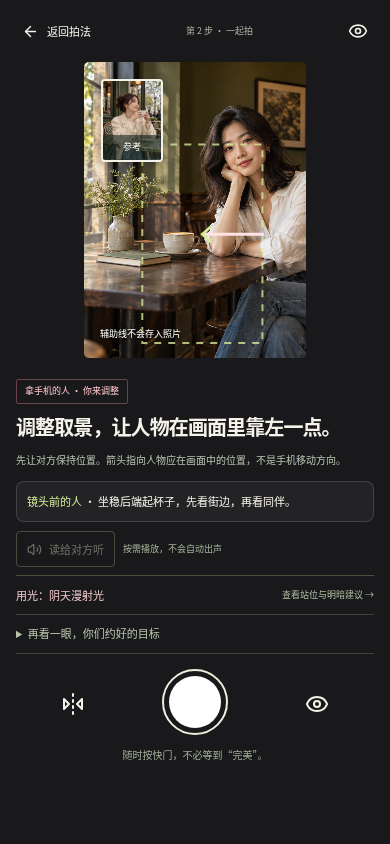

相机与结果截图使用 Canvas 视频流演示 UI，运行实际本地模型、快门、导出和停止轨道代码，**不是实体手机实拍验收**。生产界面没有这一测试流。

| 点击位置 | 行为／到哪里 | 规则 |
| --- | --- | --- |
| 返回拍法 | P5 | 停止相机及语音；保留当前拍法、最近拍摄 |
| 隐藏／显示辅助线 | 就地切换目标框、动作线和箭头 | 导出一直使用干净图像 |
| 参考小窗 | 放大／缩小小窗 | 保留原参考，用于视觉对照；场景小窗是起始场景图 |
| 读给对方听／停止提醒 | 按需播放／停止语音 | 不自动出声；不可用时直接转达文字；拍摄、离开、提示变化会停止旧语音 |
| 双人动作“对方准备好了，下一步”／再来一遍 | 顺序切换两个小动作步骤 | 先稳定构图；无人、多人或可靠性不足时暂停脚本 |
| 用光按钮 | M8 当前用光详情 | 查看站位与明暗建议，不声称实时测出光方向 |
| 再看一眼，你们约好的目标 | 就地展开双方提示与当前目标 | 不改变相机目标 |
| 镜头变焦滑杆 | 请求设备支持的变焦 | 设备未提供能力时不显示；约束失败保留当前取景并解释 |
| 切换前后相机 | 先停止旧轨道，再申请另一镜头 | 找不到请求镜头时说明正在使用可用镜头 |
| 大圆快门 | 捕获干净 JPEG 原片，进入 P7 | 即使构图未完全对齐也可主动拍；拍摄过程中禁用重复快门 |
| 查看上一张 | P7 最近选中的照片 | 有历史照片才显示，停止当前相机 |
| 重试相机／重试检测 | 重启对应流程 | 权限拒绝、没有设备、占用、模型失败有不同提示 |
| 继续拍摄（暂停状态） | 用户主动恢复相机 | 页面隐藏时先停止轨道，回来不静默重启 |

提示优先级：无人／多人／过期 → 暂停约束提示；先由拿手机的人调整人物大小和位置；框稳定后，再提示选中的手臂；稳定连续接近目标后提示保持。方向以最终取景画面为准，箭头指人物应在画面中的方向。模型不会判断美貌、微笑真假或精确光学参数。

### P7 拍摄结果

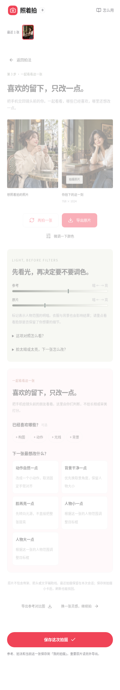
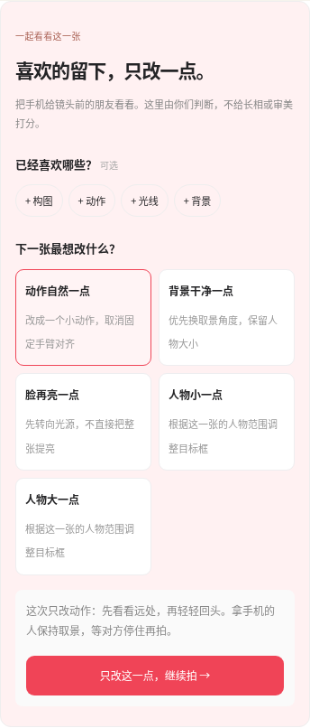
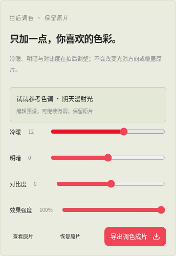

| 点击位置 | 行为／到哪里 | 规则 |
| --- | --- | --- |
| 最近 1–6 张缩略图 | 就地切换结果 | 每张对应拍摄当时的目标，不套用后面修改的拍法 |
| 返回拍法 | P5 | 回当前照片对应的拍法，照片仍保留 |
| 再拍一张 | 直接 P6 | 保留该张拍法，不重复交接 |
| 导出原片 | 下载 JPEG | 不含辅助线、不覆盖原片；失败保留当前照片并可重试 |
| 微调一下颜色 | 就地展开／收起调色区 | 调整冷暖、明暗、对比、强度；只改变预览和单独导出的成片 |
| 试试参考色调 | 应用编辑整理的色调预设 | 可继续手动调；不是自动色彩迁移或光影重建 |
| 查看原片／查看效果 | 切换预览 | 始终可回原片 |
| 恢复原片 | 重置调色并显示原片 | 不删除原图 |
| 导出调色成片 | 单独下载效果 JPEG | 原片不变；预览失败时明确提示 |
| 构图 / 动作 / 光线 / 背景 | 标记想保留的方面，可多选 | 属于用户偏好，不是自动评分 |
| 动作自然一点 / 背景干净一点 / 脸再亮一点 / 人物小一点 / 人物大一点 | 一次选择一个改动，展示下一张提示 | 与“保留”冲突时阻止应用并解释 |
| 只改这一点，继续拍 | 真正更新下一张目标，直接 P6 | 自然动作取消固定姿势约束；大小反馈用当张可靠人物范围，否则明确基于原目标框；光线与杂乱仅给现场建议，不伪造测量或直接改原片 |
| 导出参考对比图 | 下载并排对照 JPEG | 原参考／场景与原片，不是调色预览 |
| 保存这次拍摄 | 保存明确选中的结果及当时拍法 | 同一参考记录更新；不会默默保存全部最近 6 张 |
| 换一张灵感，继续拍 | 保存选择后回 P1 | 清理旧会话 URL，重要照片应先导出／保存 |

参考里存在可靠人物范围且成片也有可靠人物范围时，可对照区域像素的明暗，不将其称为人脸模型或审美分数。**场景图没有人时不运行参考人物区域亮度对照**，只给人工检查建议。

### P9 我的拍摄

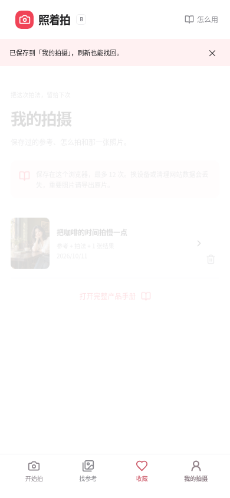

| 点击位置 | 行为／到哪里 | 规则 |
| --- | --- | --- |
| 记录图片／标题／箭头 | 恢复到 P5 | 加载参考 Blob、最新拍法和已保存结果；图能在刷新后重建 |
| 查看已拍下的照片（恢复后的 P5） | P7 | 对应已明确保存的那一张及其目标快照 |
| 开始拍摄（恢复后的 P5） | 首次双人提示后 P6 | 用户再次主动允许相机 |
| 垃圾桶 | M6 删除确认 | 不立即删除 |
| 确认删除 | 删除该记录，更新 P9 | 不能撤销；失败保留记录并解释 |
| 取消／关闭窗口 | 保留记录，仍 P9 | 已下载的原片从来不受删除影响 |
| 空列表“去开始拍” | P1 | 解释何处保存 |
| 打开完整产品手册 | H0 | 不含账号、同步或虚构云备份承诺 |

## 5. 辅助界面与全部可选交互

### 5.1 P5 的高级参考编辑

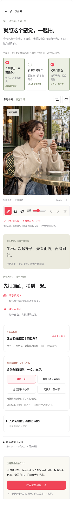

它是 P5 内展开的区域，沿用原版的能力，不增加一个必须经历的页面。

| 控件 | 行为与边界 |
| --- | --- |
| 人站哪里、画面留多少 / 参考手臂动作 / 光线与颜色 | 选一两项重点；动作需要可检测手臂；选满时提示先取消一项 |
| 裁切与人物框 | 打开 M4；变更几何会确认重置原选区，重做检测，不保留错位笔迹 |
| 顺时针旋转参考 | 旋转 90°；旋转失败保留原图；成功清除旧几何关联 |
| 更多调整（可选） | 展开局部／整图、笔迹、文字、要素、镜像等 |
| 只学选中的部分 / 整张照片复刻 | 局部按照选中的可见动作；整图纳入可用要素；切换保留局部原笔迹 |
| 画笔 / 橡皮 / 查看移动 | 涂抹选择、擦除、拖动／双指查看；只有命中可见人物部位才创建约束 |
| 画笔粗细 | 改半径；不改变之前笔迹 |
| 撤销 / 重做 / 清空涂抹 | 管理笔迹；空历史按钮禁用；涂到背景不创建动作 |
| 参考中的多人框 | 必须选一个，不能混合两个人的关键点 |
| “我理解你想拍的是”文字 | 输入未应用时阻止确认；不支持的语句保留输入并解释，不能悄悄确认旧目标 |
| 示例修改“只学抬手，不要手贴脸” | 先填入文字，仍要点应用 |
| 应用修改 / 恢复自动解读 | 支持的本地表达改变真实目标；恢复当前选择推导的文字 |
| 画面构图、机位、光影、明暗、焦点、色彩、造型、瞬间、表情 | 可逐项选择；展开每项看依据；仅构图和可用手臂进入实时约束，其他按拍前／拍后／视觉参考处理 |
| 不要手贴脸，只借抬手高度 | 仅约束相对手臂高度，取消手腕横向贴合要求 |
| 镜像学习 | 左右交换参考与手臂对应，不改变相机镜像状态 |
| 现场条件按钮 | M7 选择光线、背景、空间以及就地拍／寻找更接近参考的条件；狭窄空间不安排走动 |
| 让 AI 看看这张参考 | M3 参考发送授权；发送当前裁切图、选区、文字及可用部位，后端 `/api/interpret` 验证返回；取消／失败保留本地方案 |
| 应用这些调整 | 确认真实有效的目标，回简单拍法；不可用部位、未应用文字、未选现场用光时阻止确认 |
| 收起 / 高级区顶部返回 | 回简单拍法；未点“应用”的高级设置不作为已确认方案 |

### 5.2 辅助弹窗

| 编号 | 打开位置 | 点击后行为 |
| --- | --- | --- |
| M1 三步示例 | 首页、场景页 | 下一步／1、2、3 圆点切步；第三步“打开这个示例的拍法”以示例图进入 P5；“用我的风景开始”到 P4；关闭保留原页 |
| M2 双方提示 | 同一次拍摄首次开始 | 各一句提醒；“我拿手机，打开相机”主动到 P6；关闭回 P5；后续重拍不重复 |
| M3 AI 授权（场景／参考两个内容） | P4 或高级编辑 | 检查服务；有配置才允许明确同意；拒绝发送继续手动／本地；关闭不发送；数据只发送当张图，不发送实时视频 |
| M4 图片裁切／确认人物 | P5／高级编辑 | 原图、3:4、4:5；框移动、角点缩放、方向键微调，Shift 增大步长；裁切后继续确认人物；确认应用，关闭不应用 |
| M5 离开未保存内容 | 拍法／结果的离开入口 | 保存后离开／直接离开／继续这次拍摄；保存失败停留，不强行离开 |
| M6 删除记录 | 我的拍摄垃圾桶 | 确认删除或取消；错误保留记录 |
| M7 现场条件与几何重置确认 | 高级参考编辑 | 应用现场条件／确认重置旧几何，或取消保留原状态 |
| M8 用光详情 | 相机用光按钮 | 查阅当前用光图与具体建议；关闭返回实时相机 |

通用弹窗有标题、关闭按钮、Esc 关闭、焦点约束和关闭后焦点恢复；关闭与取消不触发相机、云请求或删除。

### 5.3 H0 产品手册

[图文手册源文件](../public/handbook.html) · [可直接阅读的 PDF](../public/guide/照着拍-产品手册-v0.6.pdf)

手册包含：30 秒上手、风景、参考与画作、双方协作、光影、重拍、保存、问题恢复。所有示例页面都有截图，不留“稍后补图”。顶部可切换 A/B 截图、下载 PDF、回到当前版本；目录锚点跳转章节；点截图打开完整大图，关闭／点击外侧／Esc 返回阅读。手机单列，电脑杂志式布局。PDF 使用 9 页独立版式，不依赖网页链接即可阅读。

## 6. 数据与生命周期

- 收藏与收起引导标记用本地存储；参考 ID 共享于同一域名的 A/B，不承诺跨站点同步。
- 拍摄记录最多 12 条，用 IndexedDB 保存图片 Blob，不保存只能活到本次会话的临时 URL。
- 同一参考 ID 对应一条记录，后续保存更新这条；新导入或新选参考创建新的会话 ID。
- 记录分开保存“最新拍法”和“已保存照片拍摄时的拍法”，避免编辑新方案后回看旧照片发生目标错配。
- 保存拍法不覆盖已保存的结果；在离开确认中保存时，同时保留最新拍法与当前结果的历史目标。
- 最近 6 张只在会话内；超出后释放最旧的一张。切换参考、清理会话和卸载会释放旧 Blob URL，但不得释放刚导入的新照片。
- 重要照片须导出；本地记录中的图像最多 1600px 长边，恢复后的尺寸标记跟随实际已保存图片。
- 相机在拍完、返回、切换镜头、隐藏页面和卸载时停止轨道。语音只按需播放，随相关状态停止。
- 场景与参考 AI 请求可取消，旧响应不得覆盖新图片、新方案或已离开的页面。

## 7. 素材与审美

本版 **20 张**：14 张日常参考、2 张真实赫本照片、4 幅真实画作。另有 1 张无人物湖边场景用于明确标记的示例。数量服从可用性与出处质量，没有把生成图冒充热点原图。

日常参考覆盖咖啡馆、建筑、书店、湖边、雨夜、野餐、街拍、海边、花园与山坡，包含半身、全身、人小景大、坐姿、走动和回头，避免只靠同一张咖啡馆照片换标题。每张写清可复刻部分、两人的动作、所需环境及可替代道具。生成图明确标为原创示例，细节页保留整张内容；首页拼图按源比例裁切，不拉伸人物。

画作是维米尔《戴珍珠耳环的少女》《窗前读信的少女》、莫奈《撑阳伞的女人》、雷诺阿《让娜·萨马里的肖像》。来源与文件记录见 [素材出处](image-sources-v0.6.md)。赫本图集可展示真实姿势，但地点未核实，不能在本版 PRD 中写成“已经验证的打卡地点库”。

## 8. 验证与后续验证重点

测试覆盖后端发送授权、同源和输入／输出验证；参考导入和本地模型；双版本导航、收藏、保存与刷新恢复；相机生命周期、干净导出、镜像、动作与光线；场景服务未开启和失败的恢复；高级修改确实回写简单拍法；手册截图和 PDF。最终结果与交付哈希见 [验收记录](acceptance-v1.5.md)。

实体手机的相机权限、前后镜头、语音、低性能设备和下载提示仍需真机验收；真实大模型的风景语义质量需要有配置的模型和用户现场照片验证。静态包可以体验本地拍摄和手动／示例方案，但不提供真正的云端风景分析。

下一轮用户验证优先观察：首次进入能否在 30 秒内找到入口；两个人是否能照提示独立完成第一张；“只改一点”是否比泛泛重拍更容易达成共识；场景建议是否可落到安全可站的真实位置。当前没有虚构留存率、成功率和社区活跃度。
