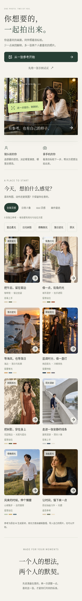
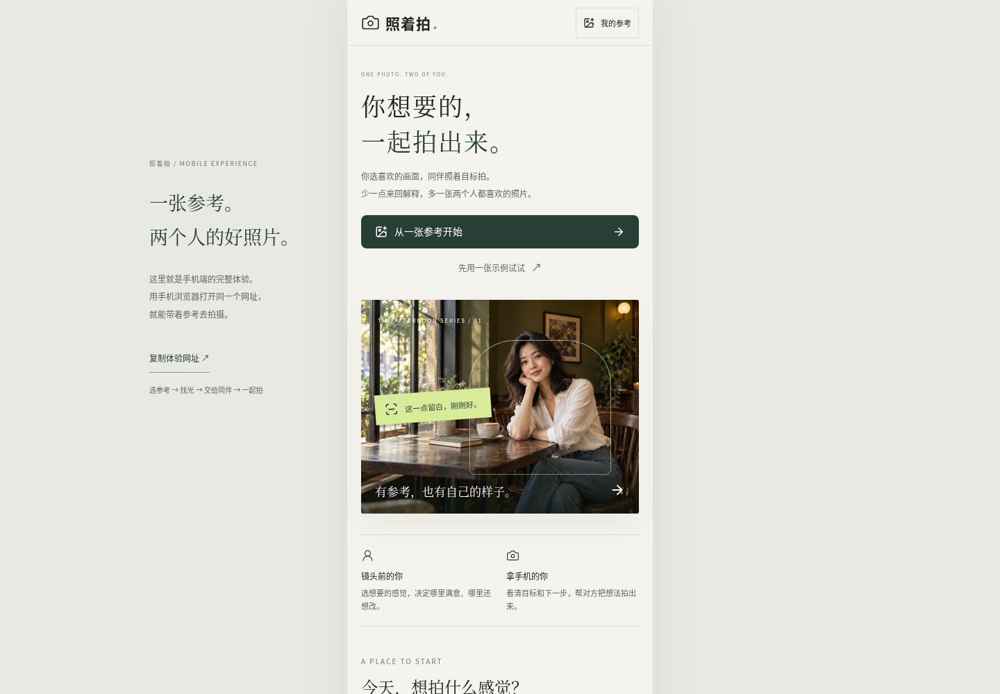
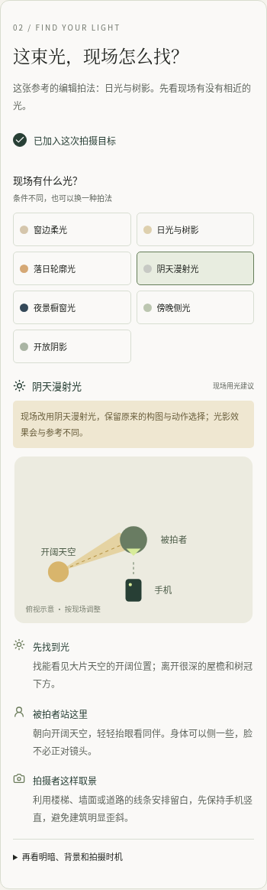
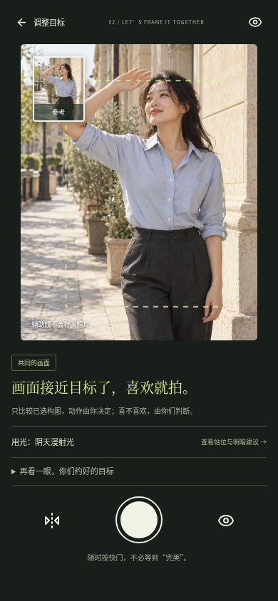
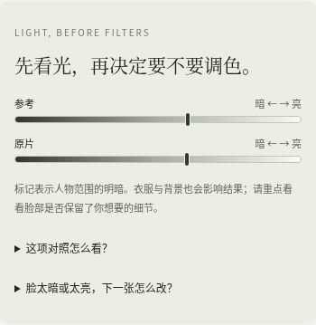

# 照着拍 v0.4 · 手机体验与现场用光

保留暖白、墨绿和摄影大图；默认以手机竖屏使用。8 张独立参考与 7 种现场用光方案，把想要的感觉变成两个人能执行的拍法。

[下载 v0.4 交互体验包](../../downloads/zhaozhepai-preview-v0.4.zip) · [上传与打开步骤](../interactive-preview.md) · [本次设计](../product-v1.3.md) · [验证记录](../acceptance-v1.3.md)

本页是截图，不能点击操作。更新网站时，需把新版 ZIP 解压后的**整个文件夹**上传到现有 Netlify 项目的 Deploys，等待 Published。GitHub 更新不会自动更新手动托管的网站。

## 手机首页与独立图库

包含窗边、街角、海边落日、雨后夜景、树影、阴天建筑、山坡和画中姿态。按光线筛选，卡片显示场景、执行条件与配色。

## 电脑上也呈现手机体验

同一套竖屏界面；可以复制当前网址到自己的手机，使用手机相机。

## 光影是主流程里的明确选择

根据现场条件选择方案，查看俯视位置图及双方动作。换一种现场用光仍保留构图与姿势选择。图是建议位置，不是现场自动测量。

## 相机里随时查看用光方案

构图、按需动作指导与快门保留。用光建议通过独立入口打开，避免遮挡取景。图中的人物来自 Canvas 测试媒体流，人体检测为实际本地模型推理；不是手机真机实拍。

## 拍后先看光，再决定调色或重拍

明暗刻度来自实际图片的人物矩形区域，不是脸部曝光评分。没有可靠范围时不显示数据。用光建议帮助决定是否换站位，调色预设由用户主动试用，原片保留。

原有双方目标卡、下一张反馈、涂抹与文字编辑继续保留。说明与边界见上方设计及验证链接。
