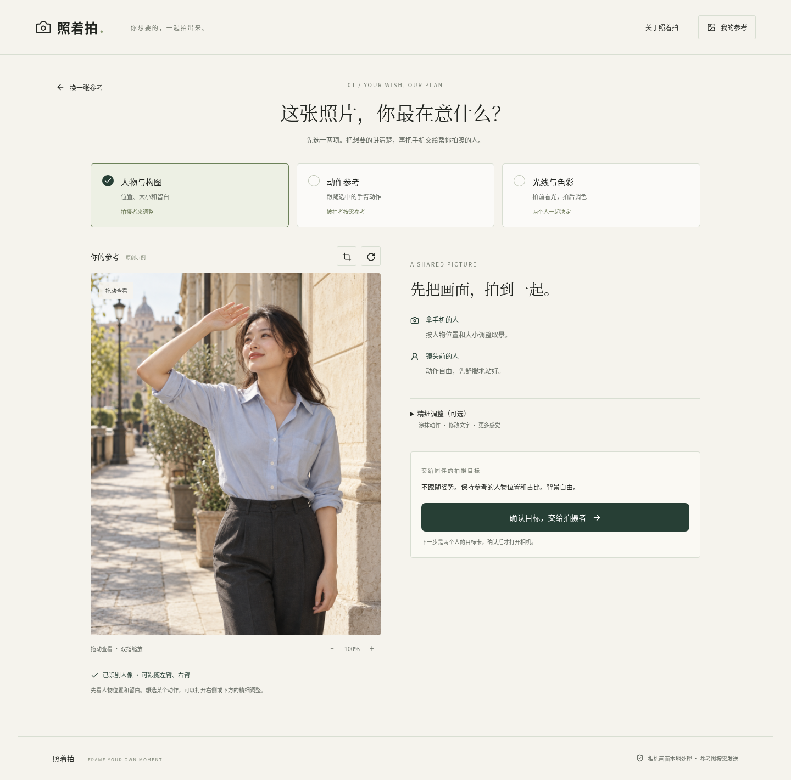
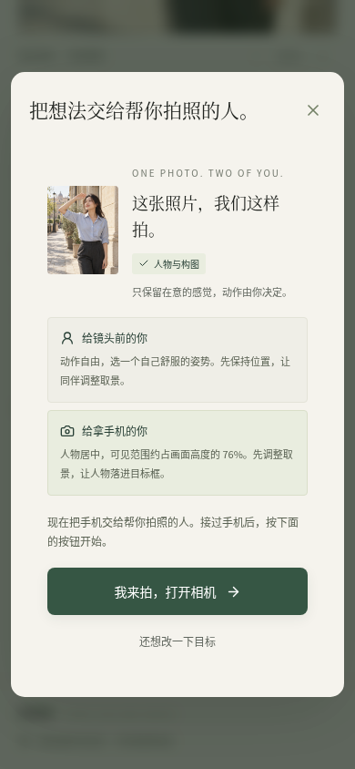
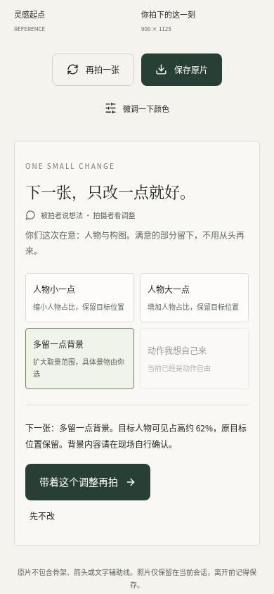

# 照着拍 v0.3 · 你想要的，一起拍出来

这是已实现的双人协作版本截图：被拍者选最在意的感觉，拍摄者接过目标执行，拍完一起决定下一张只改什么。

[产品定位与设计说明](../product-v1.2.md) · [下载最新交互体验包](../../downloads/zhaozhepai-preview-v0.3.zip) · [上传与打开步骤](../interactive-preview.md)

本页是截图，不能直接操作。交互体验需上传新版文件夹；你之前手动托管的 Netlify 网站不会随仓库更新而自动更新。

## 首页

延续暖白、墨绿和摄影大图，直接说明镜头前与拿手机的两个人各自得到什么帮助。

## 先选重点，动作可以自由

默认只跟随构图；按需加入动作或光线色彩。涂抹、文字编辑与更多摄影要素保留在精细调整中。

## 同一张目标卡，明确交接手机

被拍者确认动作是否自由，拍摄者知道人物位置与大小目标。点击「我来拍，打开相机」后才申请相机权限。

## 手机取景界面

先指导拍摄者调整构图，再按需给被拍者动作提示。每次只指导一方；动作自由时不显示动作线。人物画面来自自动化测试媒体流和真实本地模型推理，不是真机实拍。

## 拍完一起看，下一张只改一点

满意可以先保存。选择「人物小一点」「多留一点背景」等反馈，检查新目标，再交接拍下一张。反馈会实际更新取景目标；选择动作自由会移除动作纠正。

