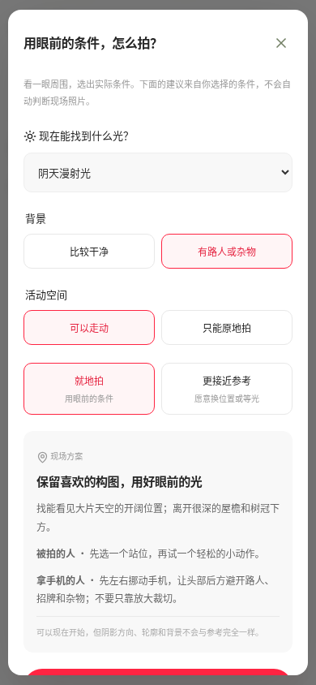
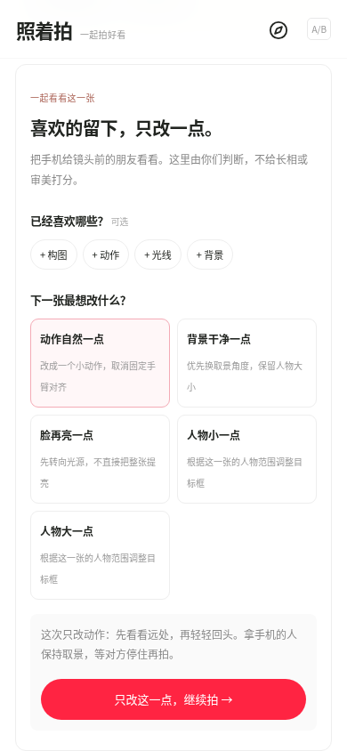

# 照着拍 · A / B 两个版本

以下为实际浏览器渲染截图。手机截图 390 × 844，桌面截图 1440 × 1000。原版源码和旧 ZIP 保留。

| A 暖色原版 | B 笔记新版 |
| --- | --- |
|  |  |

图片没有显示时，直接点击 [原版首页图片](a-classic-home.png) 或 [新版首页图片](b-notebook-home.png)，在 GitHub 文件页查看。

## 新版的几个关键页面

| 拍法笔记 | 现场取舍 |
| --- | --- |
|  |  |

| 下一张只改一点 | 刷新后的小卡 |
| --- | --- |
|  |  |

[完整参考方案页](b-reference-plan.png) · [桌面展示](b-desktop.png) · [双版本选择首页](comparison-entry.png)

[双人相机提示截图](b-camera-simulated.png)：为浏览器相机功能测试，使用参考图生成的 Canvas MediaStream，检测仍通过真实人体模型运行。该图不是手机实际拍摄效果，也不是把示例图冒充用户实拍。

[下载及上传步骤](../../dual-preview.md) · [产品取舍与能力边界](../../product-v1.4-dual.md)
